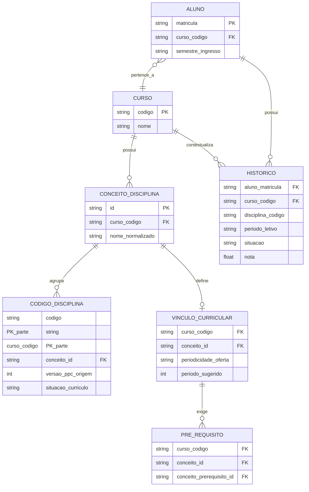

# System Design — Sistema de Apoio à Decisão de Oferta de Disciplinas

> Local no repositório: `docs/arquitetura/system-design.md`
> Última atualização: preencher data ao editar
> Status: contratos de dados validados com os CSVs reais e com a coordenação de periodicidade (Seções 3 e 5); pendências restantes listadas na Seção 10

## 1. Visão geral

Sistema de apoio à decisão que, a partir dos PPCs dos cursos e dos históricos
escolares dos alunos, estima a demanda por uma disciplina para apoiar dois
tipos de decisão da coordenação acadêmica:

1. **Oferta extraordinária** — se vale ofertar uma disciplina fora do
   semestre em que ela normalmente é ofertada (ex.: Cálculo 3, ofertada
   regularmente só em semestres ímpares, sendo avaliada para o par).
2. **Demanda no semestre regular** — quantos alunos, por curso, demandam
   uma disciplina no próprio semestre em que ela já é ofertada normalmente
   — especialmente relevante quando a disciplina é compartilhada por
   vários cursos (ex.: Cálculo 3 somando demanda de várias engenharias,
   exibida como "5 alunos da Elétrica, 3 da Engenharia de Software").

O cálculo de demanda (Grupos A, B, C) é o mesmo nos dois casos — o que
muda é se o filtro de periodicidade divergente é aplicado (modo 1) ou não
(modo 2). Ver RN02 em `Regras-de-Negócio` (Wiki) para o detalhamento.

**O critério de seleção da disciplina nunca foi obrigatoriedade/
optatividade.** No modo 1, é a **periodicidade de oferta** registrada na
matriz curricular do curso. Uma disciplina obrigatória (como Cálculo 3) é
candidata legítima de análise se sua periodicidade regular divergir do
semestre avaliado.

Não é um substituto do sistema acadêmico da universidade — é um sistema de
leitura e análise que consome exportações dele (CSVs de PPC e de histórico
escolar).

## 2. Componentes

### 2.1 CSVs de PPC e histórico (entrada)
Arquivos exportados manualmente do sistema acadêmico. Fonte de verdade para
estrutura curricular (incluindo periodicidade de oferta) e trajetória dos
alunos. Ver contratos de dados na Seção 5.

### 2.2 ETL de importação
Scripts responsáveis por ler os CSVs brutos e popular o banco de dados
(Seção 6), aplicando limpeza e validação. Responsabilidades:
- Normalizar nomes de curso e disciplina (evitar duplicidade por variação de grafia).
- Normalizar valores da coluna de situação (ex.: "Aprovado", "APR", "aprovado" → um único valor canônico).
- **Construir o mapeamento código → conceito de disciplina**, por curso, agrupando por `nome_disciplina` normalizado, a partir de todos os códigos vistos tanto no currículo quanto no histórico (ver RN06 e Seção 6 — entidade `CONCEITO_DISCIPLINA`). Esse mapeamento é a base de todas as consultas dos Grupos A/B/C, não apenas do currículo.
- Determinar a periodicidade de oferta de cada disciplina por curso (ver Seção 3 — regra de inferência a partir do histórico), aplicada ao nível de conceito, não de código isolado.
- Validar que toda disciplina referenciada como pré-requisito existe na base (por conceito, ver Seção 6).
- Reportar linhas rejeitadas/inconsistentes em vez de falhar silenciosamente — inclui códigos que não puderam ser associados a nenhum conceito conhecido.

### 2.3 Banco de dados
Armazena o estado normalizado: disciplinas, vínculos curriculares (curso ×
disciplina × pré-requisitos × periodicidade de oferta), alunos e histórico.
Ver schema na Seção 6.

### 2.4 Motor de regras
Implementa a lógica dos três grupos (A, B, C) e o cálculo de probabilidade
de aprovação do Grupo C, restrito às disciplinas cuja periodicidade regular
diverge do semestre avaliado. Consome o banco de dados; não acessa os CSVs
diretamente. Ver Seção 7.

### 2.5 Painel de gestão (dashboard, com autenticação)
Componente de saída do MVP. É um sistema web — não apenas um arquivo
exportado — que exibe o relatório de demanda de forma navegável para a
coordenação, com **login e controle de acesso**, por se tratar de um
software acadêmico que expõe dados de alunos.

Responsabilidades mínimas do MVP:
- Autenticação de usuários (login/senha; avaliar se haverá integração futura com o provedor de identidade institucional da UNIPAMPA, ou autenticação própria na primeira versão).
- Controle de acesso por papel (ex.: coordenador acadêmico vs. bolsista/equipe técnica) — a definir em `docs/01-requisitos/requisitos-nao-funcionais.md`.
- Listagem das disciplinas candidatas (periodicidade divergente do semestre avaliado) com os Grupos A, B, C e a demanda total estimada.
- Filtro por curso e por disciplina.
- Exportação dos dados exibidos (CSV/planilha), como funcionalidade complementar ao dashboard — não como substituto dele.

## 3. Periodicidade de oferta: regra de inferência (confirmada)

O PPC não tem campo de periodicidade de oferta. A regra confirmada com o
usuário é: **"ímpar" = `1. Semestre`, "par" = `2. Semestre`** — refere-se ao
semestre dentro do ano civil (ex.: 2026/01 é ímpar), **não** à paridade do
ano civil em si.

Regra de inferência para o ETL, aplicada por `(curso, disciplina)` a partir
do histórico de matrículas:

- Só apareceu em `1. Semestre`, em todos os anos observados → periodicidade = **ímpar**
- Só apareceu em `2. Semestre`, em todos os anos observados → periodicidade = **par**
- Apareceu em ambos → periodicidade = **ambos** (fora do escopo de análise do sistema — já é ofertada regularmente nos dois semestres, não há decisão de oferta extraordinária a tomar)
- Períodos letivos especiais (verão/inverno) não entram nessa classificação.

Essa regra é o que viabiliza a Seção 7 (seleção de disciplinas candidatas) — sem ela, o sistema não teria como saber quais disciplinas avaliar.

## 4. Fluxo de dados

```
CSVs (PPC, histórico)
        ↓
   ETL de importação
        ↓
   Banco de dados
        ↓
   Motor de regras (Grupos A / B / C + probabilidade,
   restrito a disciplinas com periodicidade divergente do semestre avaliado)
        ↓
   Painel de gestão (dashboard, com login)
```

## 5. Contratos de dados (CSVs de entrada)

**Importante:** as colunas abaixo são a melhor hipótese com base no que foi
descrito até agora. Antes de escrever o ETL, confirme os nomes de coluna
reais abrindo os CSVs e substitua os campos marcados `A CONFIRMAR`. Nunca
deixe o código assumir um nome de coluna sem essa confirmação — é a causa
mais comum de retrabalho neste tipo de projeto.

### 5.1 CSV de currículo / matriz curricular (`Currículo_Cursos.csv`)

Confirmado a partir do arquivo real (separador `;`, encoding `latin-1`/ISO-8859-1).

| Coluna real | Tipo | Descrição | Observações |
|---|---|---|---|
| `cod_curso` | string | Código do curso (ex.: `ALCC`, `ALEC`) | — |
| `curso` | string | Nome do curso | — |
| `cod_disciplina` | string | Código da disciplina | Uma disciplina pode ter mais de um código ao longo de reformas curriculares (ex.: Cálculo I = `AL0001`, `AL0363`, `DAL2002`) |
| `nome_disciplina` | string | Nome da disciplina | — |
| `tipo_disciplina` | string | `Obrigatória` / `Optativa` / `Disciplina Complementar de Graduação` / `Atividade Complementar` / outros raros | **Confirmado por curso** — a mesma disciplina pode ter tipo diferente em cursos diferentes. Não é o critério de seleção do sistema (ver Seção 1 e Seção 3). |
| `periodo_ideal` | float | Período sugerido na matriz (1 a 10) | Pode vir vazio para disciplinas complementares |
| `pre-requisitos` | string | Pré-requisitos **já no formato `código-nome`, separados por vírgula**, específicos desta linha (curso × disciplina) | Confirma o ADR 0001 — não precisa reconstrução |
| `equivalencias` | string | Disciplinas equivalentes (outros códigos que substituem esta) | Relevante para não subestimar aprovação de aluno que cursou uma equivalente |
| `situacao` | string | `ATIVA` / `INATIVA` — situação da estrutura curricular, não do aluno | Usar para filtrar linhas válidas |
| `num_versao` / `versao` | inteiro | Versão do PPC | **Gera linhas duplicadas por curso/disciplina** — necessário deduplicar (ver nota abaixo) |
| `creditos`, `ch_total`, `tipo_aula` | — | Carga horária e formato de aula | — |

**Sem campo de periodicidade de oferta (ímpar/par) no PPC.** Precisa ser
**inferido a partir do histórico** (Seção 5.2), olhando em quais valores de
`período` (`1. Semestre` / `2. Semestre`) a disciplina historicamente teve
matrículas, por curso.

**Premissa confirmada com o usuário:** "ímpar" = `1. Semestre`, "par" =
`2. Semestre` — refere-se ao semestre dentro do ano civil (ex.: 2026/01 é
ímpar), não à paridade do ano. Ver regra de inferência completa na
Seção 3.3.

**Deduplicação necessária:** o arquivo tem linhas repetidas por versão de
PPC (`num_versao`/`versao`, `situacao` ATIVA/INATIVA). Regra proposta para o
ETL: manter apenas `situacao = 'ATIVA'` e a versão mais recente por
`(cod_curso, cod_disciplina)`. Validar essa regra com a coordenadora antes
de implementar, pois pode haver casos de disciplinas ativas em mais de uma
versão simultaneamente.

### 5.2 CSV de histórico escolar (`Histórico_Escolar_dos_alunos_por_Curso.csv`)

Confirmado a partir do arquivo real de um curso (Ciência da Computação,
CSV) e validado num segundo curso (Engenharia Civil, arquivo `.xlsx` —
mesmas colunas, mesmo padrão; o ETL deve aceitar os dois formatos de
arquivo). Mesmo padrão de colunas nos dois: separador `;`/planilha,
encoding `latin-1`/ISO-8859-1 quando CSV.

| Coluna real | Tipo | Descrição | Observações |
|---|---|---|---|
| `matrícula` | string/int | Identificador do aluno | — |
| `cod_curso` / `curso` | string | Curso do aluno | — |
| `versão PPC` | int | Ano da versão do PPC do aluno | Cruzar com `num_versao`/`versao` do currículo ao ligar histórico à matriz correta |
| `ano` | int | Ano civil do período letivo | — |
| `período` | string | `1. Semestre` / `2. Semestre` / períodos especiais de verão-inverno | **Fonte para inferir periodicidade de oferta** (ver Seção 3 e Seção 5.1) |
| `cod_ativ_curric` | string | Código da disciplina cursada | Chave para ligar com `cod_disciplina` do currículo |
| `nome_ativ_curric` | string | Nome da disciplina | — |
| `situação na disciplina` | string | Situação do aluno na disciplina naquele período | **Valores reais confirmados:** `Aprovado com nota`, `Aprovado sem nota`, `Reprovado com nota`, `Reprovado por Frequência`, `Reprovado sem nota`, `Aproveitamento`, `Aproveitamento de Créditos`, `Dispensado com nota`, `Dispensado sem nota`, `Matrícula`, `Trancamento parcial`, `Trancamento Total`, `Trancamento por Estado de Calamidade Pública`, `SOD`, `Disciplina Não Concluída`, `Mobilidade Acadêmica`, `Incompleto` |
| `situação da matícula` | string | Situação do aluno no curso (não na disciplina) | Valores: `Formado`, `Abandono`, `Aluno Regular`, `Cancelamento`, `Reopção de Curso`, `Desligamento`, `Transferência voluntária`, `Falecimento`, `Cancelamento Sisu e Guri` — **decisão confirmada:** excluir das análises dos Grupos B e C alunos com `Abandono`, `Cancelamento`, `Desligamento`, `Falecimento`, `Cancelamento Sisu e Guri`; manter `Aluno Regular` e avaliar `Formado`/`Transferência voluntária`/`Reopção de Curso` caso a caso conforme o objetivo da consulta |
| `docentes` | string | Nome(s) do(s) docente(s) da turma | Útil futuramente para cruzar com dados de professores; pode vir vazio |
| `cod_turma` | string | Código da turma | — |

**Mapeamento de situação → estado canônico para as regras dos Grupos A/B/C**
(a normalizar no ETL):

| Situação real | Estado canônico |
|---|---|
| `Aprovado com nota`, `Aprovado sem nota`, `Aproveitamento`, `Aproveitamento de Créditos`, `Dispensado com nota`, `Dispensado sem nota` | **aprovado** |
| `Reprovado com nota`, `Reprovado por Frequência`, `Reprovado sem nota` | **reprovado** |
| `Matrícula` | **cursando** |
| `Trancamento parcial`, `Trancamento Total`, `Trancamento por Estado de Calamidade Pública` | **trancado** |
| `SOD`, `Disciplina Não Concluída`, `Incompleto`, `Mobilidade Acadêmica` | **indefinido** |

**Regra para o estado `indefinido` (decisão provisória — ver nota):**
`indefinido` é tratado como **não aprovado** para fins de verificação de
pré-requisito nos Grupos B e C — ou seja, um aluno com `indefinido` em um
pré-requisito não é considerado apto. Critério: em caso de ambiguidade, o
sistema prefere subestimar levemente a demanda a superestimá-la, já que a
coordenação toma decisões de oferta com base nesse número.

Justificativa por caso:
- `SOD`: provavelmente indica que a disciplina não teve turma ofertada no período (estado da oferta, não do aluno) — não representa aprovação real.
- `Disciplina Não Concluída` / `Incompleto`: por definição não foram concluídas.
- `Mobilidade Acadêmica`: quando validada, normalmente gera um registro `Aproveitamento` separado — enquanto esse registro não existir, não conta.

**Esta é uma decisão provisória do time técnico, não confirmada pela
coordenadora.** O volume desses estados é baixo (SOD: 152, Disciplina Não
Concluída: 79, Incompleto: 4, Mobilidade Acadêmica: 6, de ~31 mil linhas no
total), então o impacto no MVP é pequeno — mas deve ser validada com ela
assim que possível, e o relatório final deveria expor quantos alunos foram
excluídos por essa regra, para transparência da decisão.

## 6. Schema do banco de dados

**Mudança relevante nesta versão:** o schema anterior usava
`disciplina_codigo` como chave nas consultas de histórico. Dados reais de
Engenharia Civil mostraram que isso é inseguro — o mesmo conceito de
disciplina (ex.: "Cálculo I") aparece sob códigos diferentes ao longo do
tempo (`AL0001`, `AL0363`), e **a `versão PPC` registrada no aluno não
prevê de forma confiável qual código foi usado** (um aluno com versão PPC
2023 apareceu matriculado sob o código antigo `AL0001` em 2023/2). O
schema introduz a entidade `CONCEITO_DISCIPLINA` para resolver isso — ver
justificativa completa no ADR correspondente.



**Notas de modelagem:**
- `PRE_REQUISITO` é uma tabela separada de `VINCULO_CURRICULAR` porque uma
  disciplina pode ter mais de um pré-requisito por curso (relação
  um-para-muitos). A chave de consulta em todas as regras do motor é sempre
  `(curso, disciplina)`, nunca `disciplina` isolada — decisão registrada no
  ADR 0001.
- `periodicidade_oferta` substitui o que em versões anteriores deste
  documento estava descrito como campo de "tipo" (obrigatória/eletiva).
  **Esse campo não existe no modelo** — obrigatoriedade não é o critério de
  seleção do sistema.
- **`CODIGO_DISCIPLINA` é a peça nova.** Mapeia cada código bruto visto nos
  CSVs (currículo ou histórico), por curso, para um `conceito_id` único.
  Construído no ETL agrupando por `(curso, nome_disciplina normalizado)` —
  mesma técnica de RN06, agora explicitamente aplicada também ao histórico,
  não só ao currículo.
- **`HISTORICO.disciplina_codigo` nunca é sobrescrito ou descartado** — o
  código bruto original é preservado. A resolução para `conceito_id`
  acontece **em tempo de consulta** (join com `CODIGO_DISCIPLINA`,
  por `curso_codigo` + `disciplina_codigo`), não na importação. Isso
  significa que "aluno aprovado em Cálculo I" é verificado comparando o
  `conceito_id` resolvido, e não o código exato — cobrindo `AL0001` e
  `AL0363` como o mesmo conceito, sem depender de qual versão de PPC o
  aluno está vinculado.
- **`VINCULO_CURRICULAR` e `PRE_REQUISITO` referenciam `conceito_id`**, não
  código — a definição vigente de pré-requisitos, periodicidade e tipo é
  uma propriedade do conceito, escolhida a partir da linha `ATIVA` mais
  recente entre os códigos daquele conceito (regra de deduplicação, RN06).
- Códigos que não puderem ser associados a nenhum `nome_disciplina`
  reconhecido (ex.: erro de digitação no CSV, disciplina descontinuada sem
  substituta clara) ficam sem `conceito_id` e são reportados como exceção
  pelo ETL (RF05), não descartados silenciosamente.


## 7. Regras de negócio implementadas (resumo)

Detalhamento completo na página `Regras-de-Negócio` da Wiki do
repositório. Resumo operacional para quem for implementar:

**Seleção de disciplinas candidatas à análise (apenas no modo "oferta extraordinária" — RN02)**
```
SELECT (curso, conceito_id) FROM VINCULO_CURRICULAR
  WHERE periodicidade_oferta != periodicidade(semestre_avaliado)
  AND periodicidade_oferta != 'ambos'
```
No modo "demanda no semestre regular", esse filtro não é aplicado
— a disciplina é escolhida diretamente pelo usuário no painel.

**Grupo A — Matriculados**
```
SELECT alunos WHERE resolver_conceito(historico.curso, historico.disciplina_codigo) = conceito_alvo
  AND historico.curso = curso_avaliado
  AND historico.periodo_letivo = periodo_atual
  AND historico.situacao = 'cursando'
```
`resolver_conceito(curso, codigo)` é o join com `CODIGO_DISCIPLINA` — cobre
todos os códigos históricos do conceito (RN06.1), não só o código vigente.

**Grupo B — Aptos, não matriculados**
```
Para cada aluno do curso_avaliado:
  SE resolver_conceito(aluno, pre_requisito) possui situacao IN ('aprovado','aproveitado')
     PARA TODOS os pre_requisitos de (curso_avaliado, conceito_alvo)
  E resolver_conceito(aluno, conceito_alvo) NÃO possui situacao IN ('aprovado','cursando')
  ENTÃO aluno pertence ao Grupo B
```

**Grupo C — Potenciais**
```
Para cada aluno do curso_avaliado:
  SE resolver_conceito(aluno, pre_requisito) possui situacao = 'cursando'
     de algum pre_requisito de (curso_avaliado, conceito_alvo) no periodo_atual
  ENTÃO aluno pertence ao Grupo C
  probabilidade_aprovacao(aluno, pre_requisito) → Nível 1 (MVP):
     taxa histórica de aprovação do conceito de disciplina (agregada,
     somando todos os códigos históricos do conceito)
```

Demanda estimada por (disciplina, curso) = `|Grupo A| + |Grupo B| + Σ probabilidade_aprovacao(Grupo C)`

Esse cálculo é o mesmo nos dois modos de uso definidos na Seção 1 — o
resultado é a **contagem de alunos por curso**, sem conversão para número
de turmas (fora do escopo do sistema, confirmado com a coordenadora).

## 8. Decisões arquiteturais (ADRs)

Ver `docs/04-arquitetura/decisoes/`. Registradas até o momento:
- `0001-prerequisito-por-curso.md` — pré-requisito é vinculado a (curso, disciplina), não à disciplina isolada.
- `0002-criterio-e-periodicidade-nao-obrigatoriedade.md` — o critério de seleção de disciplinas candidatas é a periodicidade de oferta (ímpar/par/ambos), não o status de obrigatória/optativa. *(sugestão: criar este ADR a partir desta correção)*
- `0003-conceito-de-disciplina-para-codigos-variaveis.md` — introdução da entidade `CONCEITO_DISCIPLINA`: código de disciplina não é identidade estável (muda entre versões de PPC, e a versão do PPC do aluno não prevê de forma confiável qual código foi usado); consultas de histórico resolvem por conceito, não por código exato. Caso real documentado: Cálculo I em Engenharia Civil (`AL0001` → `AL0363`). *(sugestão: criar este ADR a partir desta correção)*

## 9. Fora de escopo (MVP)

Registrado explicitamente para evitar expansão de escopo não intencional,
seja por decisão humana ou por sugestão de ferramenta de IA:

- Nível 2 e Nível 3 de estimativa de probabilidade (histórico individual do aluno; notas parciais em tempo real).
- Integração com provedor de identidade institucional (SSO/LDAP da UNIPAMPA) — MVP usa autenticação própria simples (login/senha).
- Geração automática de grade horária ou alocação de professores.
- Integração direta com o sistema acadêmico (SIE ou equivalente) — entrada continua sendo CSV exportado manualmente.
- Conversão da demanda estimada em número de turmas/vagas necessárias — avaliado e descartado a pedido da coordenadora, que confirmou querer apenas a contagem de alunos por curso, não o dimensionamento de turmas.

## 10. Perguntas em aberto

**Resolvidas com os CSVs reais e com o usuário (Seção 3, Seção 5):**
- ~~Colunas exatas dos CSVs~~ — confirmadas.
- ~~Lista de valores únicos da coluna de situação~~ — confirmada, 17 valores mapeados.
- ~~Se pré-requisito precisa ser reconstruído~~ — não precisa, já vem por (curso, disciplina).
- ~~Se "ímpar/par" refere-se ao semestre do ano ou à paridade do ano civil~~ — confirmado: refere-se ao semestre (`1. Semestre` = ímpar, `2. Semestre` = par).
- ~~Tratamento de `SOD`, `Disciplina Não Concluída`, `Incompleto`, `Mobilidade Acadêmica`~~ — decisão provisória do time técnico: tratados como `indefinido` = não aprovado (ver Seção 5.2). **Pendente de validação da coordenadora.**
- ~~Excluir alunos evadidos das análises dos Grupos B e C~~ — confirmado: excluir `Abandono`, `Cancelamento`, `Desligamento`, `Falecimento`, `Cancelamento Sisu e Guri` (ver Seção 5.2).

**Ainda em aberto:**
- Regra de deduplicação de versões de PPC no currículo (`num_versao`/`versao`/`situacao`) — validar com a coordenadora.
- Como tratar `equivalências` — se um aluno cursou uma disciplina equivalente ao pré-requisito, deve contar como pré-requisito cumprido? (relacionado, mas distinto, do problema de `CONCEITO_DISCIPLINA` — equivalência é entre disciplinas diferentes; conceito é entre códigos do mesmo PPC ao longo do tempo)
- O agrupamento por `nome_disciplina` normalizado é suficiente para construir `CONCEITO_DISCIPLINA`, ou existem casos onde o nome muda mas o conceito é o mesmo (ex.: reforma que renomeia a disciplina)? Validar com mais cursos além de Ciência da Computação e Engenharia Civil antes de finalizar o ETL.
- Stack técnica do painel de gestão (framework web + biblioteca de autenticação) — a definir e registrar como ADR quando decidido.
- Política de senhas e recuperação de acesso para o MVP de autenticação própria.
- Formato de disponibilização do relatório final dentro do dashboard (somente visualização vs. exportação).
